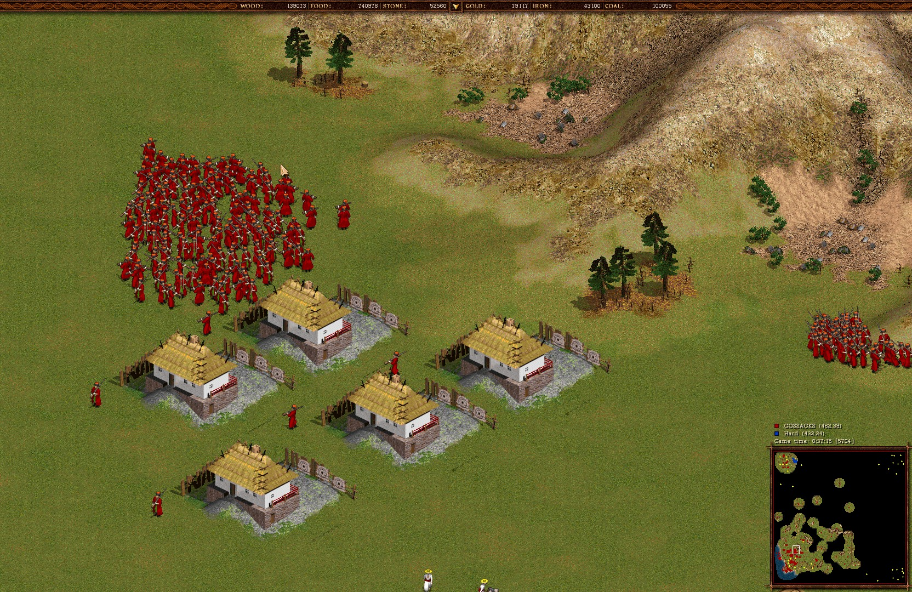
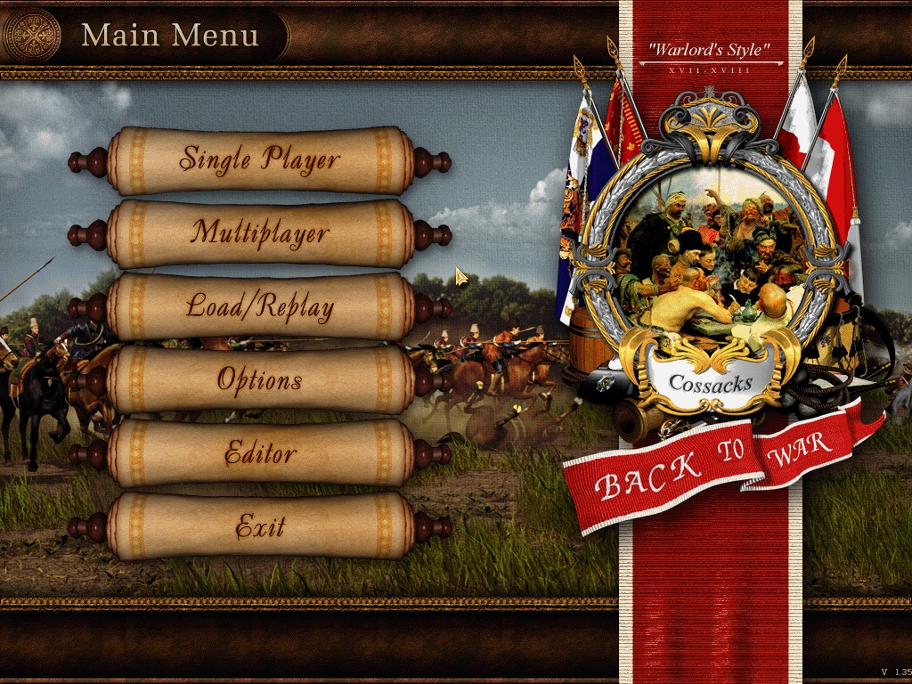
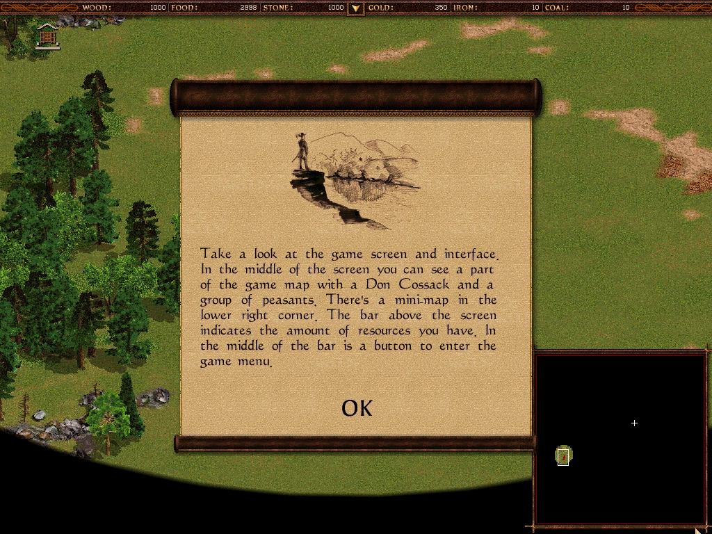

# Cossacks on Mac

Work in progress: running the original *Cossacks: Back to War* engine (`dmcr.exe`, GOG edition)
natively on a Mac with Apple Silicon. The unmodified game code runs in a small x86 emulator
(Unicorn); every Windows function it calls is rewritten for macOS (SDL2, FFmpeg).

Built on [zeus-poseidon-arm64](https://github.com/nic0lasm/zeus-poseidon-arm64), the launcher
that brings *Zeus: Master of Olympus* to the Mac the same way (see [Thanks](#thanks)).

<p align="center">
  
</p>
<p align="center">
  
  
</p>
<p align="center"><sub>A large battle in wide mode (1664 × 1080), the main menu, and the tutorial's first lesson: the original game, from your own copy, on a Mac with Apple Silicon.</sub></p>

## Status

Playable: random-map battles against the computer, the single missions and the tutorial, with
sound, music (from the GOG edition's `Tracks`), wide screen modes up to the Mac's, full screen,
the music volume kept between sessions, and Mac keys for what a Mac keyboard lacks: W A S D
scroll the map, P pauses, the delete key blows up the selection, `~` shows health.

Not yet: multiplayer, the intro and briefing videos, the in-game help, the scenario editor;
historical battles are not checked. Everything found and fixed, every workaround still to be done
properly, and the limits are in [docs/known-issues.md](docs/known-issues.md); performance work in
[docs/profiling.md](docs/profiling.md); recommended settings in
[docs/release-notes.md](docs/release-notes.md). The Windows functions the game imports can be
listed with `tools/cossacks_imports.py`.

## Download

A ready app for Macs with Apple Silicon (macOS 11 or later) is attached to each
[release](https://github.com/northdakota/cossacks-arm/releases). You need your own copy of the
game, GOG edition: installed with GOG Galaxy in CrossOver (found by itself), or its installer
unpacked with `innoextract` (the app asks for the folder with `dmcr.exe`).

The app is not notarized by Apple: the first time, macOS refuses to open it. Open it once from
System Settings → Privacy & Security → *Open Anyway*, or run
`xattr -dr com.apple.quarantine "Cossacks on Mac.app"`. Its settings, saves, crash reports and
log are in `~/Library/Application Support/Cossacks on Mac`.

## Building and running

You need a Mac with Apple Silicon, the GOG edition of *Cossacks Anthology* (installer
`setup_cossacks_back_to_war_*.exe`, unpacked with `innoextract`), and from Homebrew:

```bash
brew install cmake ninja pkg-config sdl2 unicorn ffmpeg innoextract
```

```bash
cmake -S . -B build -G Ninja && cmake --build build
```

```bash
build/cossacks-run PATH/TO/GAME/dmcr.exe --fullscreen
```

The game folder is never modified: everything the game writes (settings, saves, crash reports)
goes to `--write-dir` (default `run/cossacks`). `--language DIR` lays a language pack over the
game. `⌘F` toggles full screen, `⌘I` shows frame-rate figures. Recommended in the game's
Options: Game Mode *Slow* with Game Speed near the maximum (why: [docs/release-notes.md](docs/release-notes.md)).

If the game stops on something the launcher cannot do yet, a window says so and a report is
saved in `Crash reports`; please attach it to an issue.

The app is built for distribution with libraries made for macOS 11 and a reduced LGPL FFmpeg
(Homebrew's is GPL-3, which cannot be shipped together with Unicorn, GPL-2.0):

```bash
python3 -I tools/build_ffmpeg.py && python3 -I tools/build_mac_deps.py
```

```bash
PKG_CONFIG_PATH=$PWD/build/deps/mac/lib/pkgconfig cmake -S . -B build/release -G Ninja -DCMAKE_BUILD_TYPE=Release -DCMAKE_OSX_DEPLOYMENT_TARGET=11.0 -DCMAKE_PREFIX_PATH=$PWD/build/deps/mac -DCOSSACKS_FFMPEG=build/deps/ffmpeg && cmake --build build/release
```

```bash
python3 -I tools/make_app.py --version 0.1.0-beta
```

## Thanks

Thank you to [nic0lasm](https://github.com/nic0lasm), author of
[zeus-poseidon-arm64](https://github.com/nic0lasm/zeus-poseidon-arm64). This project would not
exist without it: the idea of running a game's original code in a small emulator and rewriting
the Windows around it, the host this launcher is built on, and the way of proving each native
replacement frame by frame all come from there. If you like old games on new Macs, go and play
*Zeus* with it.

## Origin and licence

The host (`src/win32/`) is derived from
[zeus-poseidon-arm64](https://github.com/nic0lasm/zeus-poseidon-arm64) by its authors and
contributors, licensed GPL-2.0-or-later, copied from `origin/main` at commit `9b676e5`
on 2026-11-13. Since then it has been modified for Cossacks: Zeus-specific code removed, DLL
loading with relocations, 8-bit DirectDraw with palettes, DirectSound, MCI, native sprite
blitters, a new heap, crash reports, and more; the git history records each change. See
[NOTICE](NOTICE).

This project is distributed under the same licence, GPL-2.0-or-later (see [LICENSE](LICENSE)),
for its own code and documentation only, never the game. It uses, linked at build time and not
included here: the [Unicorn engine](https://www.unicorn-engine.org/) (GPL-2.0),
[SDL2](https://www.libsdl.org/) (zlib licence) and [FFmpeg](https://ffmpeg.org/) (LGPL-2.1-or-later,
or GPL depending on how it is built).

## How it is made

The port is written with [Claude Code](https://claude.com/claude-code), Anthropic's AI coding
assistant, working with the project's author: analysis of the game's executable, the host code
and the documentation. The commits do not carry it as a co-author; this note is the credit.

## Legal

An independent, non-commercial fan project, not affiliated with or endorsed by GSC Game World,
GOG or the authors of zeus-poseidon-arm64. The repository contains no executable, artwork, sound,
text or data from the game (apart from the three screenshots of it running, in `docs/images`), and
circumvents no copy protection: it only runs the DRM-free GOG edition, from files you provide. Game files (`original/`, the installer) are kept out of git.
*Cossacks* is a trademark of its owners.
